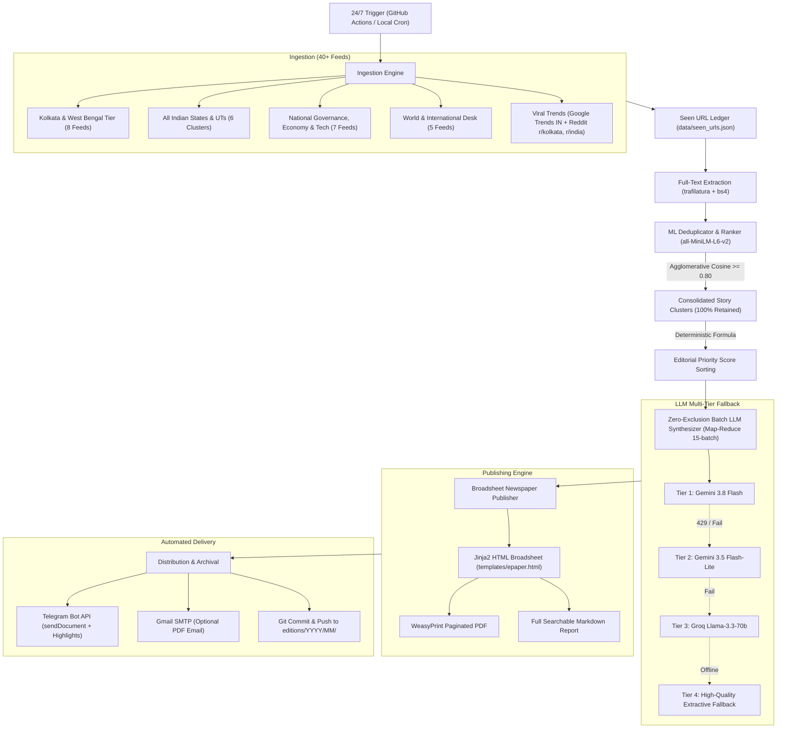

# 📰 The Daily Chronicle — Autonomous 24/7 India, Kolkata & Global E-Paper News Agent

[](https://www.python.org/downloads/)
[](https://opensource.org/licenses/MIT)
[]()

> A production-grade, 100% free, fully autonomous news intelligence and broadsheet E-Paper publishing agent. It wakes up daily at **06:00 AM IST** via GitHub Actions, aggregates current affairs and breaking news across **Kolkata, West Bengal, all Indian States, National Affairs, Global Headlines, and Viral Trends**, runs ML deduplication & editorial ranking, synthesizes structured summaries with free LLMs, renders a **newspaper-style broadsheet PDF + Markdown report**, and delivers it straight to **Telegram** (and optional Gmail) while permanently archiving every dated edition in Git.

---

## 🌟 Key Features

- **CRITICAL ZERO NEWS EXCLUSION RULE**:
  - Every unique news event reported across 40+ feeds in the rolling 24-hour window **MUST appear in the final E-Paper**.
  - ML Deduplication **only** merges multiple outlets covering the exact same event into a single consolidated cluster while listing all covering sources.
  - Singletons and hyper-local events are preserved 100%.
- **Map-Reduce Batch LLM Synthesis**:
  - Summarizes in safe chunks of 15 clusters per API call using strict Pydantic schemas to eliminate token truncation limits.
  - Multi-tier LLM fallback: **Google Gemini 3.8 Flash** &rarr; **Gemini 3.5 Flash-Lite** &rarr; **Groq Llama-3.3-70B** &rarr; **Deterministic Extractive Fallback**.
- **ML Semantic Deduplication & Deterministic Editorial Ranking**:
  - Vector embeddings via `sentence-transformers` (`all-MiniLM-L6-v2`) and Agglomerative Clustering (`threshold >= 0.80`).
  - Score Formula:  
    $$\text{Score}(C) = (W_{\text{coverage}} \times \ln(1 + |C|)) + W_{\text{region}} + W_{\text{authority}} + W_{\text{recency}}$$
  - Kolkata & West Bengal regional boost (`+2.5`), Indian States & National (`+1.5`), Global & Trends (`+1.0`).
- **Broadsheet Newspaper PDF & Markdown Publisher**:
  - Classic broadsheet typography, multi-column CSS (`column-count: 3; break-inside: avoid;`), authentic masthead, edition metadata, urgency tags, and takeaway pills.
  - Compiled to high-resolution paginated PDF via **WeasyPrint** + companion searchable Markdown archive in `editions/YYYY/MM/`.
- **Instant Multi-Channel Delivery**:
  - Pushes the daily PDF directly to your personal chat or channel via **Telegram Bot API** with executive top headline highlights.
  - Optional automated email delivery via **Gmail SMTP**.
- **100% Free & Serverless**:
  - Runs on GitHub Actions scheduled cron (`cron: '30 0 * * *'`). Zero server hosting fees, zero subscription costs.

---

## 🏛 Architecture Overview



---

## ⚙️ 5-Minute Quickstart Guide

### 1. Clone & Set Up Environment

```bash
git clone https://github.com/your-username/auto_e-paper.git
cd auto_e-paper

# Create and activate virtual environment
python -m venv venv
# Linux / macOS:
source venv/bin/activate
# Windows:
.\venv\Scripts\activate

# Install dependencies
pip install -r requirements.txt
```

### 2. Configure Environment Variables (`.env`)

Copy `.env.example` to `.env`:

```bash
cp .env.example .env
```

Open `.env` and fill in your free keys:

```ini
# Primary LLM (Google AI Studio - 100% Free)
GEMINI_API_KEY=your_gemini_api_key

# Secondary Fallback LLM (Groq Console - 100% Free)
GROQ_API_KEY=your_groq_api_key

# Telegram Bot Delivery (Free & Instant)
TELEGRAM_BOT_TOKEN=123456789:ABCdefGHIjklMNOpqrSTUvwxYZ
TELEGRAM_CHAT_ID=123456789

# Optional Gmail SMTP
GMAIL_USER=your_email@gmail.com
GMAIL_APP_PASSWORD=your_16_char_app_password
GMAIL_RECIPIENTS=your_email@gmail.com
```

### 3. Run Locally

```bash
# Run complete end-to-end edition
python src/main.py

# Test run without LLM (uses deterministic extractive summarizer)
python src/main.py --skip-llm

# Dry run (does not send to Telegram or modify seen_urls.json)
python src/main.py --dry-run

# Rapid test with limited stories
python src/main.py --dry-run --limit 20
```

### 4. Run Unit Tests

```bash
python -m pytest tests/ -v
```

---

## 🔑 Free API Keys Setup Guide

| Key Name | Where to Get | Time Needed | Free Quota |
| :--- | :--- | :--- | :--- |
| `GEMINI_API_KEY` | [Google AI Studio](https://aistudio.google.com/) &rarr; *Get API key* | 1 minute | **Free ($0)**: 10–15 RPM / 1,500 RPD |
| `GROQ_API_KEY` | [Groq Console](https://console.groq.com/keys) &rarr; *Create API Key* | 1 minute | **Free ($0)**: 30 RPM / 14,400 RPD |
| `TELEGRAM_BOT_TOKEN` | Open Telegram &rarr; search `@BotFather` &rarr; `/newbot` | 1 minute | **100% Free & Unlimited** |
| `TELEGRAM_CHAT_ID` | Open Telegram &rarr; search `@userinfobot` &rarr; Click *Start* | 30 seconds | **100% Free & Unlimited** |
| `GMAIL_APP_PASSWORD` | [Google Account Security](https://myaccount.google.com/security) &rarr; *App Passwords* | 2 minutes | **Free** (500 emails/day) |

---

## 🚀 GitHub Actions 24/7 Autonomous Deployment

1. Push this repository to your GitHub account (public repository recommended for free unlimited Actions minutes):
   ```bash
   git add .
   git commit -m "feat: complete autonomous e-paper agent"
   git push origin main
   ```
2. Navigate to your repository on GitHub:
   - Go to **Settings** &rarr; **Secrets and variables** &rarr; **Actions** &rarr; **New repository secret**.
3. Add the following repository secrets:
   - `GEMINI_API_KEY`
   - `GROQ_API_KEY`
   - `TELEGRAM_BOT_TOKEN`
   - `TELEGRAM_CHAT_ID`
   - `GMAIL_USER` *(optional)*
   - `GMAIL_APP_PASSWORD` *(optional)*
   - `GMAIL_RECIPIENTS` *(optional)*
4. Ensure GitHub Actions has write permissions:
   - Go to **Settings** &rarr; **Actions** &rarr; **General** &rarr; **Workflow permissions** &rarr; Select **Read and write permissions** &rarr; Click **Save**.
5. Trigger manually:
   - Go to **Actions** tab &rarr; Select **Daily Broadsheet E-Paper Agent** &rarr; Click **Run workflow**.

---

## 📁 Repository Structure

```
auto_e-paper/
├── .github/
│   └── workflows/
│       └── daily_epaper.yml         # GitHub Actions 24/7 cron & auto-commit
├── config/
│   └── sources.yaml                 # 40+ RSS feeds, Google News queries, weights
├── data/
│   └── seen_urls.json               # 7-day rolling deduplication ledger
├── editions/                        # Permanent dated archives (PDF, MD, HTML)
│   └── 2026/
│       └── 11/
│           ├── Daily_Chronicle_2026-11-15.pdf
│           ├── Daily_Chronicle_2026-11-15.md
│           └── Daily_Chronicle_2026-11-15.html
├── src/
│   ├── collectors/
│   │   ├── rss_collector.py         # Concurrent RSS & Google News parser
│   │   └── trends_collector.py      # Google Trends & Reddit sentiment
│   ├── ml/
│   │   └── deduplicator_ranker.py   # SentenceTransformers + Cosine clustering
│   ├── llm/
│   │   └── synthesizer.py           # Zero-exclusion batch map-reduce LLM
│   ├── publisher/
│   │   ├── epaper_builder.py        # Jinja2 broadsheet & WeasyPrint PDF
│   │   └── distributor.py           # Telegram bot & Gmail SMTP dispatcher
│   └── main.py                      # Pipeline master orchestrator
├── templates/
│   ├── epaper.html                  # Authentic broadsheet newspaper template
│   └── epaper.css                   # Multi-column CSS print stylesheet
├── tests/                           # Unit & integration test suite
│   ├── test_collectors.py
│   ├── test_deduplicator.py
│   ├── test_synthesizer.py
│   ├── test_epaper_builder.py
│   └── test_distributor.py
├── .env.example                     # Environment template
├── .gitignore
├── requirements.txt
└── README.md
```

---

## 📜 Editorial Sections

1. **★ Front Page Lead Stories**: Top 6–8 highest-scoring stories across all categories with full takeaways.
2. **❖ Kolkata & West Bengal Desk**: 100% of civic, cultural, political, and industrial developments in Kolkata and Bengal.
3. **❖ Indian States & Union Territories Digest**: State-by-state coverage tagged with `[STATE NAME]` spanning Northern, Southern, Western, Central, Eastern, and North-Eastern India.
4. **❖ National Affairs, Governance & Economy**: Central policy, PIB releases, RBI decisions, infrastructure, and technology.
5. **❖ World & International Desk**: Geopolitics, global economics, diplomacy, and breaking foreign dispatches.
6. **❖ Viral Trends & Social Sentiment Radar**: Real-time Google Trends search volumes and community discussions from `r/kolkata`, `r/india`, and `r/IndianStockMarket`.

---

## 📄 License

This project is licensed under the MIT License — see the [LICENSE](LICENSE) file for details.
